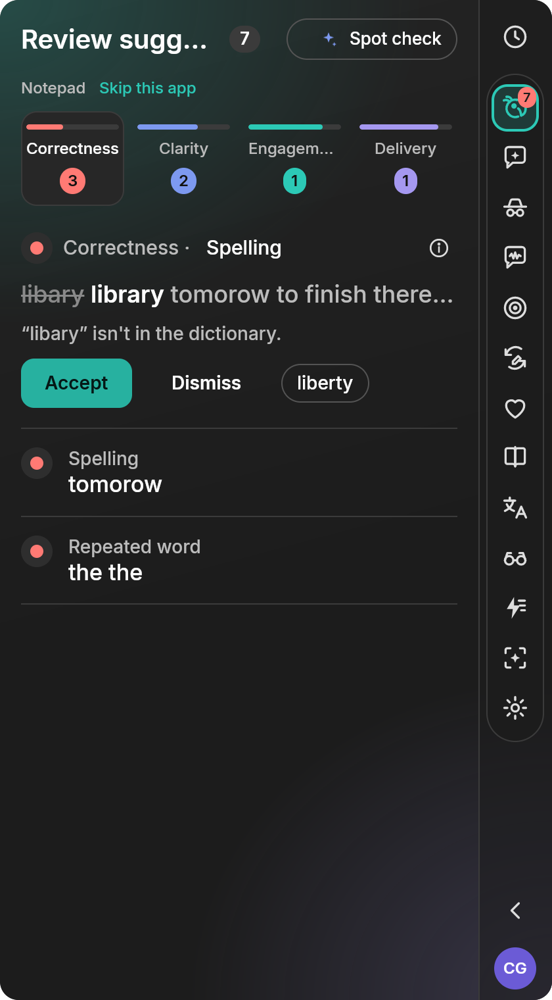
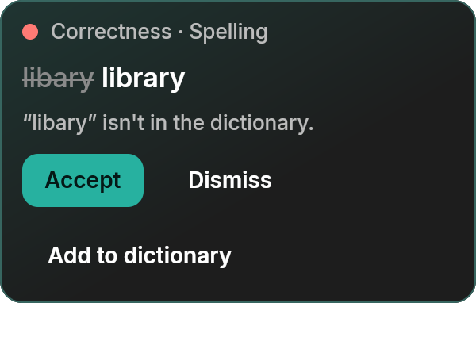

# Oumu

A writing assistant that checks spelling and grammar in the app you're typing in (Notepad,
browsers, Discord, Office, GTK and Qt apps...), underlines mistakes and fixes them in place.
Optional AI tools (paraphrase, humanize, reader reactions, translate, explain, tone, AI
detector, AI rewriter, summarize, chat) use your own AI key or a local model.

Written in Rust on the [Rune](https://github.com/anomalyco/rune) UI toolkit. Runs on
**Windows 10/11 (x64)** and **Linux (Wayland, Hyprland)**.

| Review panel | Suggestion card |
|---|---|
|  |  |

The Tauri version of Oumu is kept in this repo's history: tag `tauri-final`.

## Install on Windows

Build the installer from source (there are no prebuilt downloads yet):

1. Install [Rust](https://rustup.rs) and the
   [Visual Studio Build Tools](https://visualstudio.microsoft.com/visual-cpp-build-tools/) with
   the "Desktop development with C++" workload. `rust-toolchain.toml` picks the Rust version.
2. Build (takes a while the first time):
   ```bash
   cargo build --release -p oumu
   cargo build --release -p setup
   ```
3. Run `target\release\oumu-setup.exe`. It installs per user (no admin), adds a Start menu
   entry, starts with Windows, and can be removed from Settings > Apps.

## Install on Linux

1. Tools (Arch): `sudo pacman -S --needed rust wl-clipboard`. Oumu reads text fields through
   the accessibility bus (AT-SPI), which it switches on itself.
2. Build and install to `~/.local` (no root): `packaging/linux/install.sh`
   (`--autostart` adds a login entry; Ryoku's Hub already starts `oumu` at login).
   Remove with `packaging/linux/uninstall.sh`.

Linux notes: the panel is placed through Hyprland's IPC, so other Wayland desktops are
untested.

## Privacy

- No accounts, telemetry or update checks.
- Spelling and grammar checks run on your PC ([Harper](https://writewithharper.com)). Text
  leaves your PC only when you use an AI tool (it goes to the AI provider you set up, with your
  key) or the plagiarism check (short quotes go to a web search).
- Your AI key is stored in your settings file: `%APPDATA%\dev.cratusgod.oumu\settings.json` on
  Windows, `~/.local/share/dev.cratusgod.oumu/settings.json` on Linux.

## Development

```bash
cargo test --workspace
cargo run -p oumu
```

- `cargo build --profile fast`: an optimized build in about half the time of `--release`; set
  `CRATUS_PROFILE=fast` to point the test scripts at it.
- Headless UI tests (no screen, mouse or keyboard): `tests\oumu_headless.ps1` on Windows,
  `python3 tests/linux/headless.py` on Linux.
- Real-screen tests (they move the mouse and type; leave the PC alone meanwhile):
  `tests\oumu_e2e.ps1` and `tests\install_test.ps1` on Windows, `tests/linux/oumu_e2e.py` on
  Linux. Every AI tool with every option: `tests/linux/oumu_ai_all.py` (uses your AI key,
  never printed).
- Design notes, Rune patches and lessons learned: [docs/NOTES.md](docs/NOTES.md).

`vendor/rune` is Rune at rev `c369cc0` with a few patches (search for "cratus-rs"), and
`vendor/winit` is Rune's winit with one fix. Their licenses are in those folders.

## License

Oumu (`crates/oumu`, `crates/oumu-rt`) is [AGPL-3.0-or-later](crates/oumu/LICENSE), like the
original Oumu. The shared crates and the build tooling are [MIT](LICENSE).
